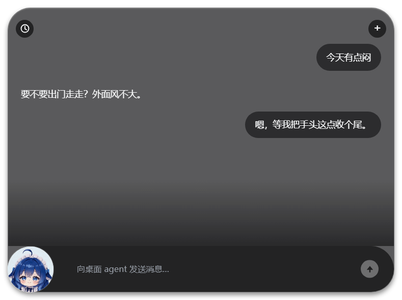
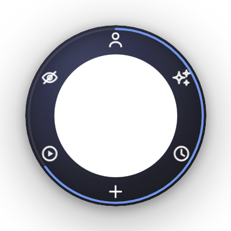

<div align="center">

# Orb · 一颗会记事的桌面悬浮球助手

**Windows 桌面 AI 助手**：常驻屏幕右沿，不挡事。<br>
记忆是一堆 markdown 文件 + 一个 git 仓库 —— 重启之后它还是它，把文件夹拷到另一台机器也不会失忆。

[下载出厂版](https://github.com/AmazingdaiWeii/memo-orb/releases) · [从源码跑](#从源码跑) · [装 360 的先看这条](#装-360-的话先看这条) · [它和普通聊天窗口有什么不一样](#它和普通聊天窗口有什么不一样)

</div>

---

## 长什么样

<table>
<tr>
<td align="center"><br><sub>常驻在屏幕右沿的小球</sub></td>
<td align="center"><br><sub>左键展开就是对话面板</sub></td>
<td align="center"><br><sub>右键是环菜单</sub></td>
</tr>
</table>

## 它是什么

一颗悬浮在桌面上的小球。左键展开是对话面板，右键是环菜单（换形象 / 看过的视频 / 设置 …）。

它不是一个网页套壳：大脑在本机跑（自建引擎，直连 OpenAI 兼容接口），会话、记忆、登录态全存在你自己的盘里；除了模型接口本身，不依赖任何外部服务。

三个设计红线：

1. **独立启动** —— 不依赖任何宿主进程，双击就能跑
2. **不干扰** —— 不与别的程序抢端口（控制 socket 用 `listen(0)` 动态端口）
3. **轻** —— 500 MB 量级

## 它和普通聊天窗口有什么不一样

**记忆是真的。** 不是「把聊天记录塞回上下文」那种记得。记忆是一份 git 版本化的 markdown 仓：`MEMORY.md`（四节固定：关于他 / 关于我自己 / 约好但还没做的 / 索引）、`about/印象.md`、`journal/YYYY-MM.md`（append-only）。你怎么称呼、它答应过你什么，都写在里面，每次改动都是一次 commit —— 所以能翻历史、能回滚。

**两条会话，一份记忆。** 桌面上找它，或者微信里找它，是同一个它。

**会自己看 B 站。** 丢一个视频链接过去，它真的会看画面（取关键帧，原生分辨率）；认真看还是快速看由它自己判断，不是给你一个「画质」菜单让你选。它记得自己看过什么，环菜单里有「看过的视频」。

**会说话。** 接上语音之后，它说的每句话都会念出来。文字 → 音频整条链路都在内存里走，磁盘上不会因为说话多出任何文件。

**知道自己的钱包。** 每轮上下文里有一行余额真数（问服务商接口，5 分钟缓存），贵的事做不做，它自己掂量。

**人格是一份 markdown。** `鲸鱼娘_persona.md` 就是它的性格正本，每轮全文注入。想换一个它，改这个文件。

## 1.01 更新了什么（2026-10-23）

两个功能，都围绕「记忆」这件事：

**① 冻结 / 唤醒记忆（存档时光机）** —— 设置面板 →「她眼中的你」页面底部多了「冻结记忆」「唤醒记忆」。冻结会把此刻的记忆仓与会话整体存成一份存档（`.orb-snapshots/` 下的一个文件夹，带 `manifest.json` 与逐文件 sha256，可以逐条核对）；唤醒是从任意一份存档回滚。唤醒之前会自动再备份一次现状，所以点错了也能退回去。存档只含记忆与对话，不含 API key 等凭据。
已知限制：唤醒之后要重开一次软件才生效；界面上没有「撤销」按钮，回退靠那份自动备份。

**② 记忆写入改造** —— 以前她改记忆是「整篇重写」，改一条也可能把整份文件写坏。现在多了 `patch_memory` / `memory_batch` 两个工具，只替换命中的那几行（实现见 `src/memstore-local.mjs` 的 `applyEdits` / `findClosestLines` / `patch`）：不会整篇写坏，也不必每次重发整份全文。

**已经装了 1.0 的不用重下 184 MB**：Release 里另有一个约 405 KB 的增量补丁 `patch-to-1.01.zip`，解开后放进安装目录、双击 `apply.bat` —— 只动 22 个文件（20 个替换、2 个新建，解开约 1.1 MB），`data/`、`config.json`、人格卡、`runtime/` 一概不动，跑完自动生成 `_rollback-1.0-<时间戳>\restore.bat` 可整份回滚。

设计细节与边界见 [2026-10-23 功能更新说明](docs/2026-10-23功能更新说明.md)。

## 三步装上（Windows x64）

1. **下载** —— 在 [Releases](https://github.com/AmazingdaiWeii/memo-orb/releases/latest) 里下 `Orb_v1.01_windows_x64.zip`（约 184 MB）；已经是 1.0 的，改用同页那个 `patch-to-1.01.zip`（约 405 KB）。旁边那个 `.sha256` 是校验用的，想验就验
2. **解压** —— 解到一个**普通目录**，别放 `C:\Program Files` 这种要管理员权限的地方（首次启动会在 exe 旁边建 `data/`，那儿得能写）
3. **填模型** —— 双击 `Orb.exe` → 右键小球 → 设置 → 「API」分组 → 填 API Key 和模型名（DeepSeek，或任何 OpenAI 兼容网关）→ 保存（**装了 360 的话先看下一节**，它会把这个 exe 静默拦掉）

不用装 Node、不用装 Python、不用装任何运行库。首次启动 Windows 会弹 SmartScreen（没买代码签名证书），点「更多信息 → 仍要运行」。

界面上的 `data/` 是它自己建的，存会话、记忆仓、登录态。**包里不带任何人的私人凭据**：微信是可选的，不填就一个字节都不收发；模型 key 也只存在你自己这台机器的 `data/providers/auth.json` 里。

## 装 360 的话先看这条

**2026-10-23 实测**：在装了 360 安全卫士（家庭版）的 Windows 上，双击 `Orb.exe` **没反应、也不报错**。从命令行启动才看得到 `拒绝访问。` / `Access is denied.`（WinError 5）—— 进程根本没被创建起来，所以没有崩溃、没有日志、弹窗也没有。

排查时排掉的东西（都是实测，不是猜）：文件没坏（重新解压、SHA256 与 Release 的 `.sha256` 一致）、目录权限正常（往同一个目录里丢一个 `notepad.exe` 能跑）、不缺运行库、不是 SmartScreen。把 `Orb.exe` 复制到别的盘、改名、甚至改掉文件哈希，一样被拒；而 **360 的隔离区里没有它** —— 它不是被"查杀"了，是被「主动防御 / 木马防火墙」挡在创建进程那一步。

### 为什么会这样

360 没有给出书面理由，所以下面分开写。

**事实**

- `Orb.exe` **没有代码签名**（`Authenticode` 验签结果 `NotSigned`，本项目没买证书）
- 拦的是 `Orb.exe` 和 `runtime\electron\electron.exe`；把 `electron.exe` 改个名（`ele3.exe`）就能启动 → 360 对 `electron.exe` 这个文件名有专门规则
- 改哈希、改名都躲不过 → 不是 MD5 黑名单，是对"这类程序"的行为规则
- 换 Windows Defender 的机器、或任何没装 360 的机器，同一个包正常跑

**推断（无官方文档背书）**：360 主动防御对「未签名 + 不在白名单 + 启动后立刻拉起子进程并往用户目录写文件」的新程序，按可疑下载器 / 捆绑包处理，直接在 `CreateProcess` 阶段拒绝。Electron 打包的程序尤其容易中枪 —— 恶意软件常用 `electron.exe` / `nw.exe` 这类宿主伪装，这几个文件名在国产杀软里已有成套规则。这是「个人项目、自己编译、没签名、没提交过检测」要付的系统性代价，不是这个仓库特有的问题。

### 怎么让它跑起来

1. **加信任（最快，推荐）** —— 360 安全卫士 → 左侧「木马查杀」→ 右下角「信任区」→「添加信任目录」，选中你解压出来的整个 `Orb_factory_...` 目录（**别只加 `Orb.exe`**，它还要启动 `runtime\electron\electron.exe`）。加完再双击。
   已经被拦进隔离区的：同页右下角「恢复区」→ 恢复，并勾选加入信任区。
2. **只想确认是不是它干的** —— 临时关掉 360 的「木马防火墙 / 主动防御」启动一次，验完**记得开回去**。
3. **治本：提交误报进官方白名单** —— [360 软件开放平台误报反馈](https://open.soft.360.cn/report.htm)：填邮箱 + 上传 `Orb.exe` + 截图 + 说明「个人开发的开源 Electron 应用，被主动防御拦在创建进程阶段」，官方口径 1–2 个工作日处理；也可以发 `opensoft@360.cn`。
4. 不想折腾就换 Windows 自带的 Defender，或在没有 360 的机器上跑。

### 顺便确认下载没坏

被拦时很容易以为是包坏了。把下载到的 zip 和同名 `.sha256` 放一起：

```powershell
Get-FileHash .\Orb_v1.01_windows_x64.zip -Algorithm SHA256
```

等于 `.sha256` 里那串（Release 说明里也写着）就说明文件完整，起不来纯粹是安全软件拦的。

### 从源码跑

需要 Node ≥ 22.19。`package.json` 是**零依赖**的，不用 `npm install`。

差一个 Electron 运行时：`runtime/`（约 367 MB）不进 git，自己准备一份：

```powershell
# 任选其一：把 electron 放进 runtime/electron/，或直接指定路径
$env:ORB_ELECTRON = "D:\path\to\electron.exe"
node src\launch.mjs
```

启动失败不会闪退（`src\launch.mjs` 用普通 Node 跑，报错留在控制台），日志在 `logs\orb.log` —— 排障第一入口。

## 配置

全在 `config.json`，改完重启生效（部分项运行期改即生效）：

| 键 | 说明 |
|---|---|
| `model` | 模型名，`openai-compatible/<模型>` 或服务商自己的写法 |
| `agentName` / `theme` / `locale` | 显示名 / 主题 / 语言 |
| `electronPath` | Electron 可执行文件，**支持相对路径**（相对项目根），所以整个目录搬盘不用改配置 |
| `engine` | `local`（默认，自建引擎）\| `legacy`（旧后端，仅历史保留，跑不起来） |
| `contextBudgetTokens` | 上下文预算旋钮，默认 24 000，上限 = 模型上下文，**运行期改即生效** |
| `adoptHostWechatCreds` | 是否允许从本机 `~/.dsh` 搬微信凭据。**出厂默认 `false`** |

模型 Key 不进 `config.json`，落在 `data/providers/auth.json`（首次在设置页「API」分组里填，不用手改文件）。

## 目录

| 路径 | 作用 |
|---|---|
| `src/` | 后端全部源码：主进程、自建引擎、长记忆、会话、压缩、工具层、微信桥、TTS |
| `helper/` | 球的窗口层与渲染层（`assets/*.js` 是可读源码，直接改） |
| `鲸鱼娘_persona.md` | 人格正本，`src/persona.mjs` 每轮读它注入 system |
| `tools/` | 构建与运维脚本：打出厂包、造 agent、审计导出物 |
| `probe/` | 行为探针（自动化测试），一个功能一个文件 |
| `docs/` | 四篇可公开的开发笔记（00 从这里读起 / 01 开发手册 / 02 已趟过的坑 / 2026-10-23 功能更新说明）——出厂包里的 `开发笔记/` 就是它们的原样拷贝；另有一篇只在仓库里、不进出厂包的设计文档《长记忆是怎么闭环的》；还有 README 用的三张截图 |
| `data/` | **运行时生成**：会话、记忆仓、登录态、日志。不进 git |
| `runtime/` | 自带 Electron 运行时，不进 git |

## 已知限制

- 只打过 **Windows x64** 的包；macOS / Linux 没试过
- **会被国产杀软误拦**：未签名的 `Orb.exe` 在 360 下会被「主动防御」直接拒绝创建进程（表现为双击无反应），需自己加信任，见上文「装 360 的话先看这条」
- 没有安装器，就是解压即用（首次启动手工填一次模型 key）
- 微信桥要自己扫码配对；语音要自己的火山引擎（豆包）或 OpenAI 兼容 TTS 的 key
- **只能出声，不能听**：语音是单向的，没有语音输入
- 记忆是文件，不是训进权重里 —— 换机器要把 `data/` 一起搬走才不失忆（好在它是个 git 仓，能翻也能备份）
- B 站与微信都依赖第三方协议，随时可能失效，仅供个人学习用

## 素材与署名

默认球脸、6 张情绪装饰图、页面背景**全部为本项目自制**，可随仓库自由分发。上游 `dsh-orb` 的原素材未获授权，已从仓库移除。

第三方组件与素材清单见 [`THIRD-PARTY-NOTICES.md`](THIRD-PARTY-NOTICES.md)；素材规格与命名规则见 [`helper/assets/avatars/README.txt`](helper/assets/avatars/README.txt)。

> 本项目由个人开发者维护，与 DeepSeek AI 无任何隶属、认可或合作关系。代码与文档中出现的 "DeepSeek" 字样仅指其作为可选模型服务商之一，属描述性提及。

## 许可（License）

**随便玩，别拿去赚钱。**

本项目以 [PolyForm Noncommercial 1.0.0](LICENSE) 授权。简单说：

- ✅ 自己用、自己改、改完分享给别人、装在自己电脑上、教学、非营利机构使用 —— 都可以，不用问
- ❌ 商业用途 —— 打包进你卖的产品、放在收费服务里、公司内部当生产工具、拿它做二次开发去卖，都**需要先单独取得授权**
- 分发时请把 `LICENSE` 一起带上（里面的 `Required Notice` 那行不能删）

严格讲这不是 OSI 认可的开源许可（「禁止商用」这一条就把它挡在门外了），所以准确的说法是「**源码可见 · 非商业授权**」。要商用直接开个 issue 谈。

公开仓库里能看到的**发帖素材、设计文档、人格文档**同样适用这条；第三方组件仍按各自的许可证走（见 [`THIRD-PARTY-NOTICES.md`](THIRD-PARTY-NOTICES.md)）。

## 更多文档

- [从这里读起](docs/00_从这里读起.md) —— 接手前先知道的几件事、30 秒环境事实、文档怎么读
- [开发手册：架构与历史](docs/01_开发手册_架构与历史.md) —— 架构、目录职责、素材与署名、历史决策的来龙去脉
- [已趟过的坑：球侧问题清单](docs/02_已趟过的坑_球侧问题清单.md) —— 被推翻的错误结论、红线、事故复盘 —— **动手前必读**
- [2026-10-23 功能更新说明](docs/2026-10-23功能更新说明.md) —— 1.01 的冻结/唤醒与记忆片段替换：设计、边界、已知限制
- [长记忆是怎么闭环的](docs/长记忆闭环设计.md) —— 记忆仓的三层结构、一轮对话里怎么进上下文、她怎么写进去、写坏了怎么退、上下文爆了怎么压；五条不变量与边界（**只在仓库里，不随出厂包发**）
- [第三方组件与素材](THIRD-PARTY-NOTICES.md) —— Electron、上游素材、各自的许可证
